# Visual testing guide

A screenshot-driven walkthrough of InternHub, captured from a real local run against Postgres + the Express API (per `README.md` > Setup). This complements `TESTING.md`; it doesn't replace the automated tests or the full field-by-field data model reference there.

Every screenshot below was taken live — clicking through the actual seeded app (`npm run seed`), not mocked — so what you see is what a real walkthrough looks like today.

## Sign in

The login page. Sessions are a JWT in an httpOnly cookie set by `POST /auth/login`.

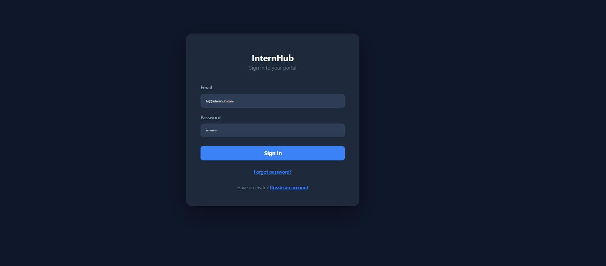

Signing in redirects by role: HR → `/hr/dashboard`, Manager → `/manager/dashboard`, Intern → `/intern/dashboard`.

The sidebar (hamburger menu, top-left) shows role-scoped navigation and the logout control at the bottom:

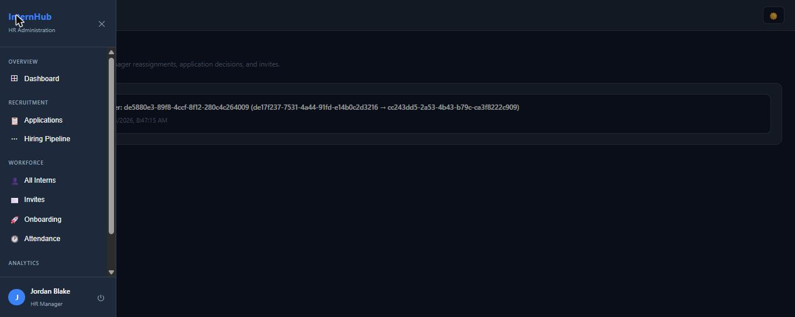

## HR walkthrough

**Dashboard** — team-wide snapshot: intern/manager counts, active tasks, completion rate.

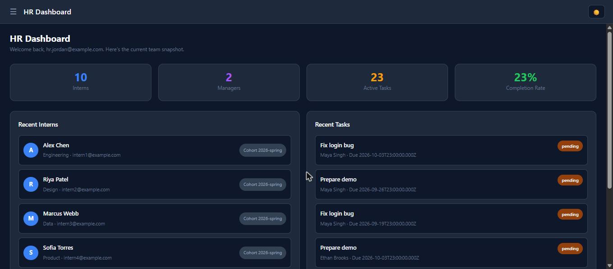

**All Interns** — roster with department/cohort filters, manager reassignment dropdown, and deactivate/reactivate.

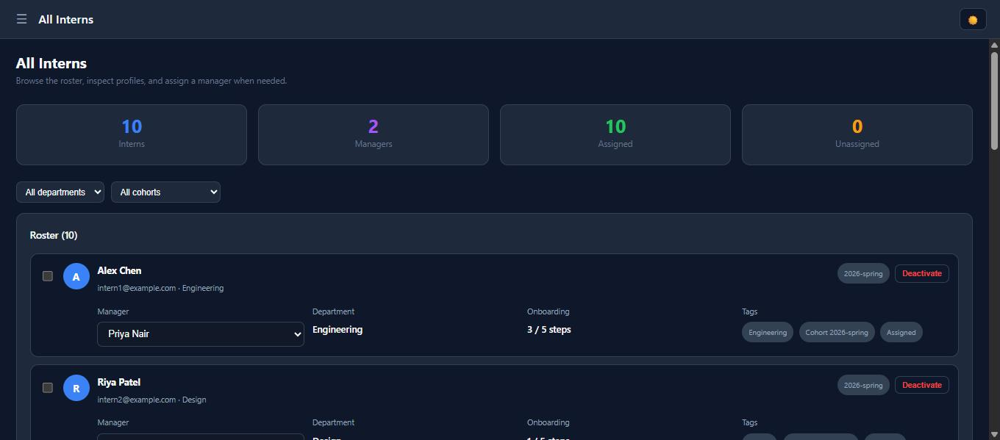

Reassigning an intern's manager (via the dropdown) takes effect immediately — here Riya Patel moved from Sam Okafor to Priya Nair:

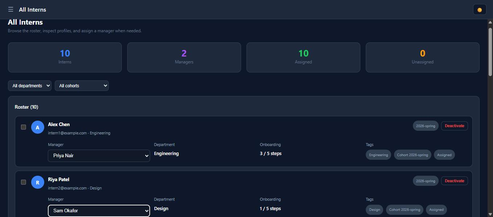

**Invites** — HR provisions every new account this way (no admin console). Sending an invite:

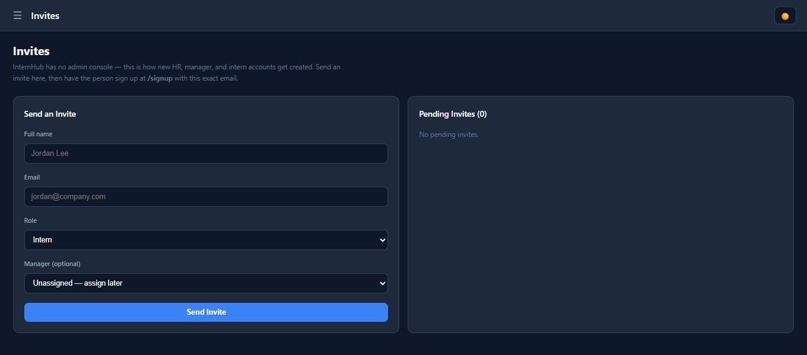

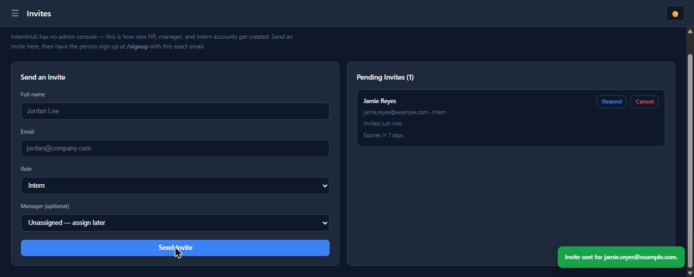

**Hiring Pipeline** — recruitment board by stage (New → Screening → Interview → Offer → Onboarding / Rejected).

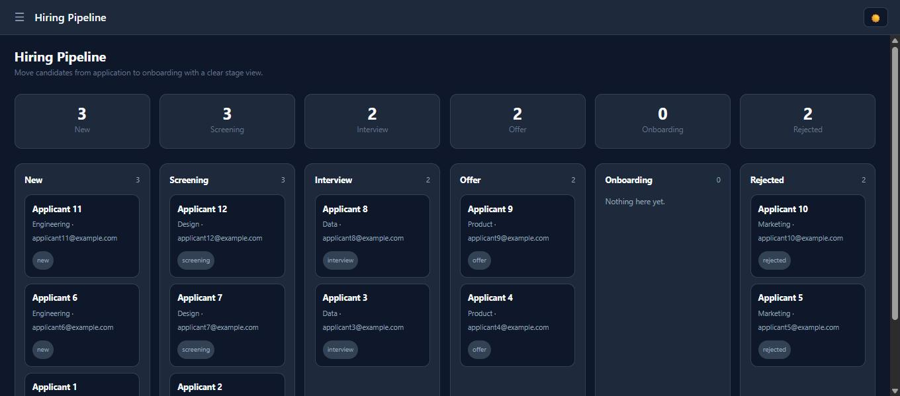

**Applications** — shortlist/reject candidates, export CSV.

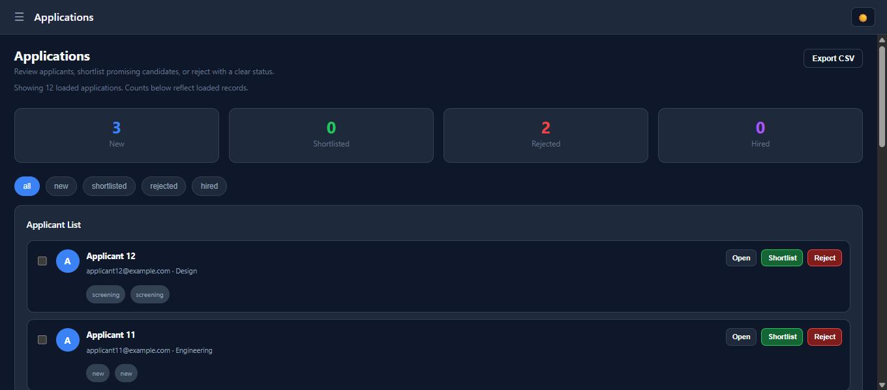

**Attendance** — cross-team attendance log with exception/comment fields.

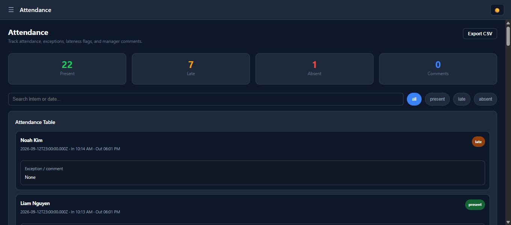

**Reports** — recruitment funnel, task breakdown, onboarding progress, and 7-day attendance, computed live from the same data the other pages read.

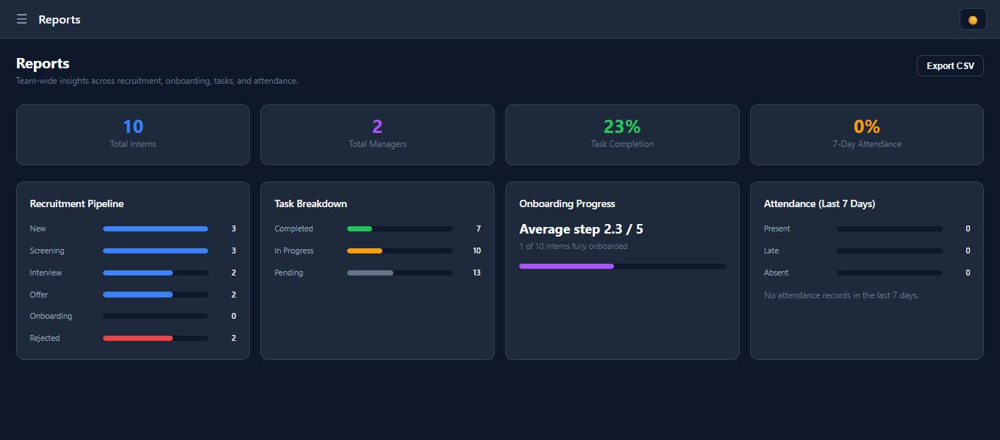

**Activity Log** — append-only audit trail. Every HR mutation with a server-side authorization consequence gets logged automatically (`server/utils/activityLog.js`); this entry was generated by the manager reassignment above:

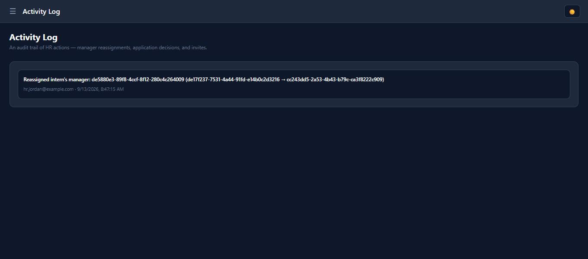

> Note: entries currently reference actors/targets by uid, not display name (visible above as raw UUIDs). This is carried over from the pre-migration behavior, not a regression — resolving names client-side would be a nice follow-up, not a blocker.

## Manager walkthrough

**Dashboard** — scoped to the signed-in manager's own interns only (6 here, after the reassignment above added Riya). Includes a weekly digest of overdue tasks and attendance flags.

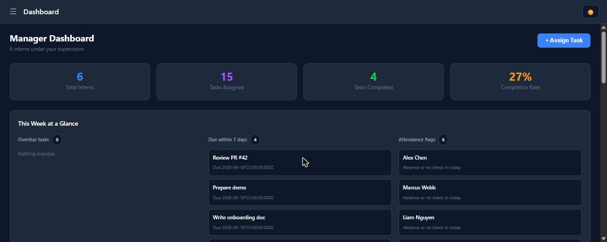

**My Interns** — per-intern task/onboarding progress with quick actions.

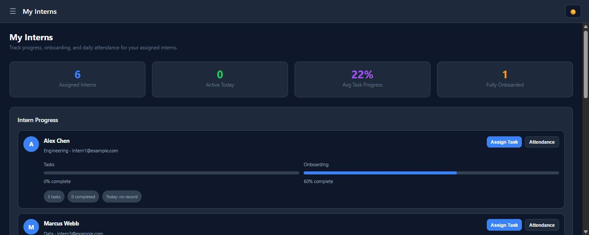

**Tasks** — create/edit/delete tasks for assigned interns, and thread comments on any task:

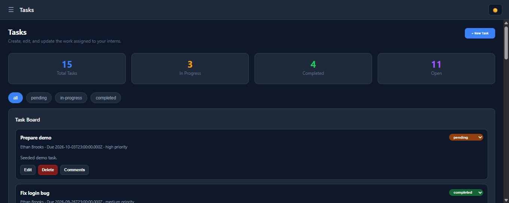

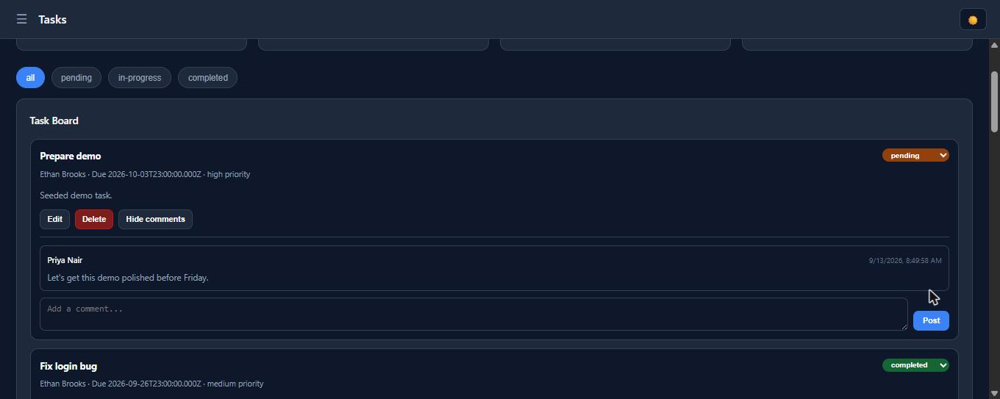

**Attendance** — review team attendance and add manager comments.

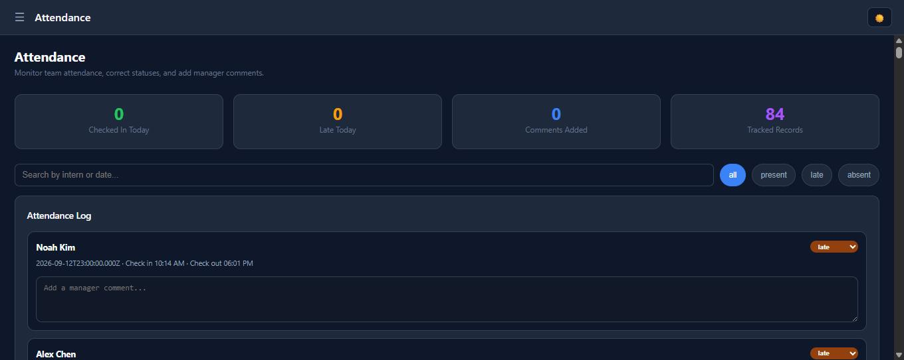

## Intern walkthrough

**Dashboard** — scoped to the signed-in intern's own tasks and onboarding.

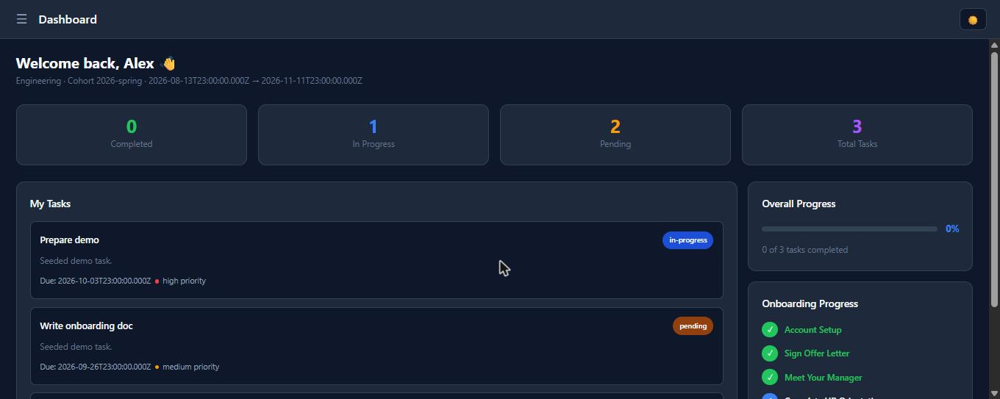

**Tasks** — an intern can change `status` but not title/description/due date (enforced server-side, not just hidden in the UI).

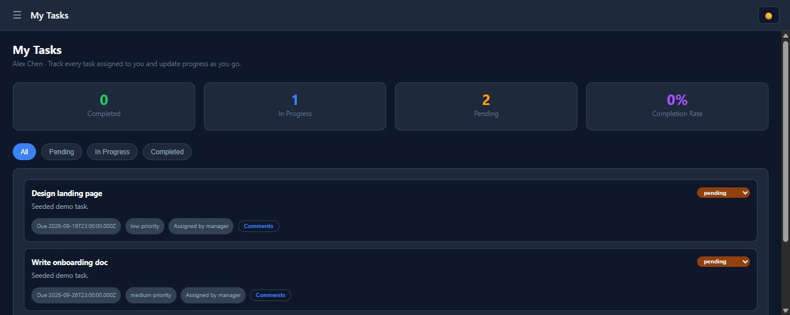

**Attendance** — check in/out for the day. The API rejects a duplicate same-day record with 409, surfaced here as a toast (this record already existed from seeding):

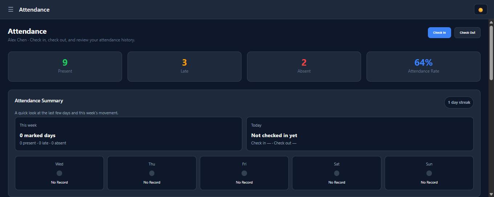
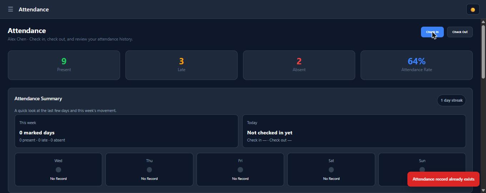

**Onboarding** — checklist and step progress, self-editable.

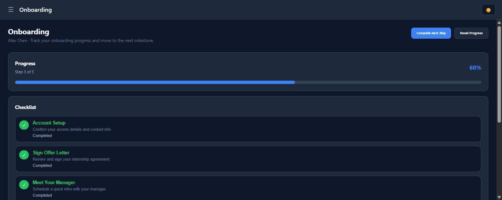

## Account provisioning end-to-end

Signing up at `/signup` with the exact invited email consumes the invite and creates the account in one step — here signing up as the `jamie.reyes@example.com` invite sent above lands straight on a fresh intern dashboard:

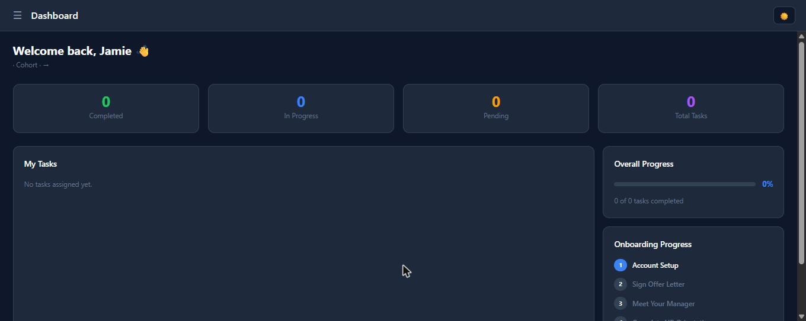

## Forgot / reset password

No email provider is wired up (see README > Known gaps), so `/forgot-password` always shows the same message regardless of whether the account exists, and the actual reset link is logged to the server console instead of emailed:

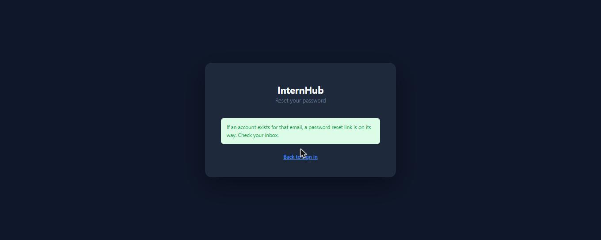

Opening that link and setting a new password:

Logging in with the new password immediately afterward confirms the full loop works.

## What this run confirmed works end-to-end

- Login/logout, session cookie, role-based redirect
- Invite → signup → account creation → invite consumed
- Forgot password → console-logged reset link → reset → login with new password
- HR: manager reassignment (with activity log entry), invites, pipeline, applications, attendance, reports
- Manager: dashboard scoping (only own interns), task CRUD, task comments
- Intern: dashboard/task scoping, attendance check-in with correct 409-on-duplicate handling, onboarding

No bugs were found during this pass beyond the cosmetic activity-log UUID display noted above.
